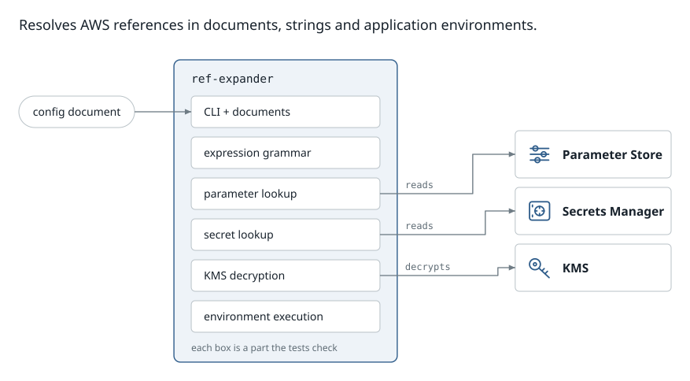

# AWS reference expander for configuration and environments

Resolve AWS references in configuration documents, strings and child-process environments; rebuild the CLI's lookup, expansion, rendering and execution behavior.

## The program
`ref-expander` is a CLI for operators preparing application configuration from SSM Parameter Store, Secrets Manager and KMS-encrypted values. `program eval -f config.yaml -o json` expands a YAML/JSON document, `get` expands one string, `env` prints shell assignments, and `exec` launches a command with resolved variables. References such as `ref+awsssm://app/db/host` identify values to fetch; fragments select fields within structured values.

## What the solver gets
The solver gets a working build to run but not read, an interface guide and a local AWS-compatible emulator. The guide outlines commands, expression syntax and backend parameters but leaves map shaping, rendering and failure details open. Any installed language is allowed. Source and `build.sh` belong under `/app`; the offline build must produce `/app/program`. Only `/app` transfers to grading.

## What must be rebuilt
- **CLI + documents**: Support standard input, files, recursive directories and multiple documents in YAML or JSON. Preserve types, match top-level sequence handling, suppress logs with `-s`, and emit no output on failed expansion.
- **expression grammar**: Match boundaries, explicit `+` terminators, nested references and `secretref+` exclusion. Whole-value substitutions preserve types, while embedded maps, lists and null require particular text rendering.
- **parameter lookup**: Resolve plain, SecureString and StringList parameters, historical versions and regions. Reproduce recursive prefix maps, complete paginated results, `mode=singleparam` fragments and missing-key rules.
- **secret lookup**: Read strings and binary values by name or ARN, select versions by ID or staging label, and honor regions. Resolve structured fragments and distinguish missing keys from null values and invalid traversal.
- **KMS decryption**: Decode padded URL-safe ciphertext and handle encryption contexts, key identifiers, aliases and algorithm parameters. Select typed fragments from decrypted documents and match failures for invalid encodings, contexts or keys.
- **environment execution**: Quote shell assignments, support `-export`, and reject non-string variables. Construct child environments with optional inheritance, pass arguments and streams through, and prevent execution when resolution fails.

## How it is graded
Hidden tests create fresh parameters, versioned secrets and symmetric KMS keys, then invoke the rebuilt commands with documents, strings and child commands. Results must match the reference build's behavior: decoded document values and types, exact `get` and child output, environment lines regardless of order, and zero versus non-zero exit status. Missing resources, malformed input, incompatible version selectors and incorrect encryption contexts exercise failure paths.

## Why it is hard
The guide leaves subtle interactions to observation. Prefix lookup differs from parsing one parameter, `get` and `eval` treat missing keys differently, and adjacent expressions can make rendering depend on position. Shell quoting and environment inheritance add another observable contract.

## Real-world basis
Modelled on an open-source configuration reference expander that retrieves external values for documents and application environments.

## Task facts

| | |
|---|---|
| Task | `swe-cloud/pc-ssm-secretsmanager-reference-resolver` |
| Type | Program construction |
| AWS services | Parameter Store, Secrets Manager, KMS |
| Language | Any installed language |
| Runtime | Local AWS-compatible emulator. No internet access. |
| Hidden tests | 53 test functions |
| Agent time limit | 4 hours |
| Resources | 2 CPUs, 4 GB memory |
