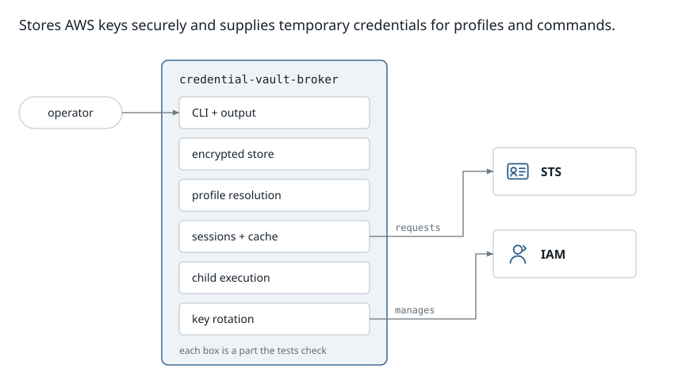

# AWS credential vault and command runner

The credential-vault-broker stores AWS access keys and supplies temporary credentials; the solver must rebuild its CLI, encrypted storage, profile handling, and command execution.

## The program
An operator runs `credential-vault-broker` to keep long-term keys in an encrypted local file store and obtain credentials for AWS config profiles. `add --env` stores a key pair, `export` prints credentials, and `exec PROFILE -- COMMAND` launches a command with them. STS supplies temporary user sessions and assumed-role credentials; IAM supports access-key rotation through `rotate`.

## What the solver gets
The solver gets a working executable to run but not read, an interface guide, and a local AWS-compatible emulator. The guide lists commands, config keys, and output comparison rules, leaving profile resolution, duration precedence, caching, and rotation behaviour to discover. Source and an executable `/app/build.sh` must build `/app/program` under `/app`, using any installed language. Only `/app` transfers, and builds and grading run offline.

## What must be rebuilt
- **CLI + output**: Match JSON, env, export-env, and INI credential exports, aligned list tables, and filtered lists. Invalid flags, unknown profiles, and nested execution must produce the expected refusals.
- **encrypted store**: Implement add, replacement, and removal, config updates, case-sensitive names, and store-location overrides. Secrets must stay out of plaintext files, and the wrong passphrase must prevent access.
- **profile resolution**: Resolve `source_profile` and `include_profile`, detect loops, and honour config-file overrides. Match region, endpoint, and account-ID precedence.
- **sessions + cache**: Use `GetSessionToken` or `AssumeRole` as appropriate, with matching durations and role-chain caps. Reproduce cache reuse, refresh thresholds, per-profile clearing, and failure behaviour.
- **child execution**: Match the complete child environment, including removed stale AWS settings. Preserve arguments, standard streams, and exit status, and fail when the command is missing.
- **key rotation**: Replace the correct stored key through IAM, delete the old key, and clear affected sessions. Match masked progress messages and leave keys and sessions unchanged for rejected rotations.

## How it is graded
Hidden tests create fresh vault homes, AWS config files, IAM users, access keys, and roles. They drive command sequences and compare behaviour with the reference build's results: parsed exports, output lines, table alignment, session listings, child environments, and exit statuses. They validate credentials with `GetCallerIdentity` and inspect IAM access keys independently. Unreachable endpoints, wrong passphrases, profile loops, and failing rotations check error handling and preserved state.

## Why it is hard
An alias has its own cached session, while assumed-role credentials are obtained anew. A cached session can override a newly requested duration, and role chains cap longer requests. Replacing or rotating a key clears only particular sessions. These interactions, plus exact environment cleanup and config precedence, require observing more than isolated successful commands.

## Real-world basis
Modelled on an open-source AWS credential manager that stores access keys securely and runs commands with temporary credentials.

## Task facts

| | |
|---|---|
| Task | `swe-cloud/pc-sts-credential-vault-broker` |
| Type | Program construction |
| AWS services | STS, IAM |
| Language | Any installed language |
| Runtime | Local AWS-compatible emulator. No internet access. |
| Hidden tests | 47 test functions |
| Agent time limit | 4 hours |
| Resources | 2 CPUs, 4 GB memory |
